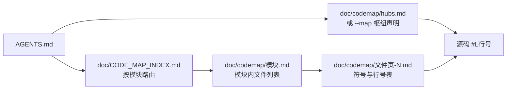

# 代码地图使用教程（给 Agent）

> 目的：让任何 Agent 在修改或分析本仓库代码前，先通过「代码地图」在 1~3 次工具调用内拿到 `路径:行号`，再定点读取源码，避免全仓盲扫。
> 权威说明见 [CODE_MAP.md](CODE_MAP.md)；项目规范与核心铁律见 [AGENTS.md](../AGENTS.md)。

## 1. 它是什么

- **确定性静态符号索引 + 导入级引用图**：记录 `src/`、`test/`、`scripts/`、`doc/` 下每个源码文件的函数、类、方法、接口、类型别名、枚举、变量声明及精确行号，并统计文件间 `import` 入度排出架构枢纽（Hubs）。
- **不是**调用图（Call Graph），也不替代 TypeScript 类型检查、LSP 或单元测试。
- `doc/CODE_MAP_INDEX.md`、`doc/codemap/hubs.md` 与 `doc/codemap/` 全部由 `node doc/codemap.mjs` 自动生成，**严禁手动编辑**。

## 2. 分层结构



| 层级 | 位置 / 命令 | 内容 |
| --- | --- | --- |
| 0 枢纽层 | `node doc/codemap.mjs --map` / `doc/codemap/hubs.md` | 被其他文件 `import` 次数最多的核心类型、服务类与工具函数 |
| 1 索引层 | `doc/CODE_MAP_INDEX.md` | 10 个业务模块的文件数、符号数与全局统计 |
| 2 模块页 | `doc/codemap/<模块>.md` | 模块内文件清单、各文件符号数及符号页链接 |
| 3 符号页 | `doc/codemap/<路径>-<hash>-<页>.md` | Symbol / Kind / Scope / Line（直接跳转到源码 `#L行号`） |

## 3. 定位顺序（按已知信息选最省 Token 的一步）

1. **不知道从哪下手**：运行 `node doc/codemap.mjs --map`（或读 `doc/codemap/hubs.md`），先看被导入最多的核心声明（如 `SessionInfo`、`getWebviewContent`、`ClaudeConfigManager`、`SessionManager`、`parseTranscriptFile`）。
2. **知道符号名**：运行 `node doc/codemap.mjs --find <名字>`，一步拿到 `路径:行号`。
3. **知道文件名**：运行 `node doc/codemap.mjs --outline <文件>`，按源码顺序查看该文件的全部声明。
4. **按业务模块探索**：读 [CODE_MAP_INDEX.md](CODE_MAP_INDEX.md) → 打开对应模块页 `doc/codemap/<模块>.md` → 进入目标文件符号页 → 根据行号定点读取源码片段。
5. **查调用链或引用**：代码地图只统计 `import` 语句；要查方法调用、事件监听或 Webview 消息分支，请结合 `Grep` 或 LSP `usages`。

### 本项目模块速查表

| 想找什么 | 模块名 | 包含源码文件 |
| --- | --- | --- |
| 插件激活入口、VS Code 命令注册、全局数据结构与类型定义、中英双语国际化字典 | `core-entry` | `src/extension.ts`、`src/commands.ts`、`src/types.ts`、`src/i18n.ts` |
| 侧边栏 Dashboard Webview 容器、前端 HTML/CSS/JS 渲染与通信、底部状态栏控制与格式化、终端会话管理 | `ui-dashboard` | `src/dashboardView.ts`、`src/webviewHtml.ts`、`src/statusBar.ts`、`src/statusBarFormatter.ts`、`src/terminalManager.ts` |
| 会话目录扫描与监听、`transcript.jsonl` 流式解析與 Fork 重写、Transcript 全文检索、时间线事件提取、Fork 差异对比 | `session-parser` | `src/sessionManager.ts`、`src/transcriptParser.ts`、`src/transcriptSearch.ts`、`src/timelineEvents.ts`、`src/forkCompare.ts` |
| 会话置顶、会话标签、上下文与空闲告警、会话导出（Markdown / JSON） | `session-ops` | `src/sessionPins.ts`、`src/sessionTags.ts`、`src/sessionAlerts.ts`、`src/sessionExport.ts` |
| 任务/计划权威状态管线：`~/.claude/tasks/` 原生任务读取、`TaskCreate`/`TaskUpdate`/`TodoWrite`/Checklist 合并与展示策略、`CLAUDE_CODE_ENABLE_TASKS` 环境策略 | `todo-tasks` | `src/nativeTasks.ts`、`src/taskIntegration.ts`、`src/todoDisplay.ts`、`src/projectTodoPolicy.ts` |
| `~/.claude/settings.json` 与网关模型缓存管理、MCP 服务与 Skills 扫描启停、跨平台配置目录与工作区路径编解码 | `config-features` | `src/claudeConfigManager.ts`、`src/claudeFeatures.ts`、`src/configDir.ts` |
| 模型上下文窗口上限解析、模型名称格式化、Token 计费单价表与成本估算、工作区费用汇总报表、Anthropic OAuth 订阅用量拉取 | `usage-pricing` | `src/contextLimit.ts`、`src/modelPricing.ts`、`src/workspaceCost.ts`、`src/subscriptionUsage.ts` |
| 单元测试套件（解析器、官方 Task、待办展示策略、价格覆盖、费用统计、全文检索、Fork 对比、顶部工具栏等） | `tests` | `test/*.test.ts`（共 12 个测试文件） |
| 本地一键编译、测试与 `.vsix` 打包脚本 | `scripts` | `scripts/package.ps1`、`scripts/package.sh` |
| 代码地图生成器脚本 | `tooling` | `doc/codemap.mjs` |

## 4. 符号页字段说明

| 列名 | 含义 |
| --- | --- |
| `Symbol` | 符号名称（函数、类、接口、方法、属性、类型别名、枚举、变量等） |
| `Kind` | TypeScript AST 语法节点类型（如 `FunctionDeclaration`、`ClassDeclaration`、`InterfaceDeclaration`、`MethodDeclaration`、`VariableDeclaration`） |
| `Scope` | 词法父级作用域（如 `SessionManager.refresh` 的 Scope 为 `SessionManager`；顶层声明为空） |
| `Line` | 声明所在源码行号，带 Markdown 相对链接直达源码 `#L行号` |

## 5. 常用命令速查

在项目根目录（`E:\W-AI_WorkSpace\claude_hub_for_vscode`）执行：

```powershell
node doc/codemap.mjs                                  # 全量/增量生成代码地图
node doc/codemap.mjs --module todo-tasks              # 仅刷新单模块（需缓存有效且无模块外改动）
node doc/codemap.mjs --check                          # 校验代码地图是否与当前源码零漂移
node doc/codemap.mjs --find parseTranscriptFile       # 按名字查找符号定义位置
node doc/codemap.mjs --find Task --limit 30           # 模糊前缀/子串搜索符号并指定返回上限
node doc/codemap.mjs --outline src/transcriptParser.ts # 列出单个文件的全部声明
node doc/codemap.mjs --map --tokens 600               # 按 Token 预算输出核心枢纽概览
```

## 6. 改完代码后的必做清单

1. **刷新代码地图**：任何源码文件新增、修改、删除或重命名后，执行 `node doc/codemap.mjs`。
2. **校验零漂移**：执行 `node doc/codemap.mjs --check`，确认 `changed: 0`、`deleted: 0`，且 `diagnostics` 保持基线 `0`。
3. **编译与测试门禁**：执行 `npm run compile` 与 `npm test`，确保编译零错误且所有单元测试 100% 通过。
4. **打包规范检查**：若涉及打包 `.vsix`，必须输出至 `dist/` 目录（`npx vsce package --no-dependencies --out dist/`）。

## 7. 常见问题（FAQ）

| 现象 | 原因与处理方式 |
| --- | --- |
| `node doc/codemap.mjs --check` 退出码非 0 | 改动了源码但未重新生成地图；运行 `node doc/codemap.mjs` 后再执行 `--check` |
| `--module <name>` 报错拒绝执行 | 存在模块外文件改动或缓存冷启动；直接运行无参数的 `node doc/codemap.mjs` |
| 某个函数/方法没出现在 `hubs.md` | `hubs.md` 只统计跨文件 `import` 顶层声明，类方法和同文件内部调用不计入度；用 `Grep` 搜索调用点 |
| `webviewHtml.ts` 内部的前端 JS 函数搜不到 | `webviewHtml.ts` 中的前端脚本位于模板字符串内，TypeScript AST 只提取外层 TS 声明；前端内联函数请在该文件内用 `Grep` 定位 |
| `scripts/package.ps1` 和 `package.sh` 符号数为 0 | 这两个脚本是顶层顺序命令流，没有定义 `function`，因此文件被索引但符号数为 0 |
| 想手动修改 `doc/CODE_MAP_INDEX.md` 或 `doc/codemap/*.md` | **严禁手改**；所有生成页由 `node doc/codemap.mjs` 维护，手写说明统一放在 `doc/CODE_MAP.md` 与 `doc/codemap-guide.md` |
